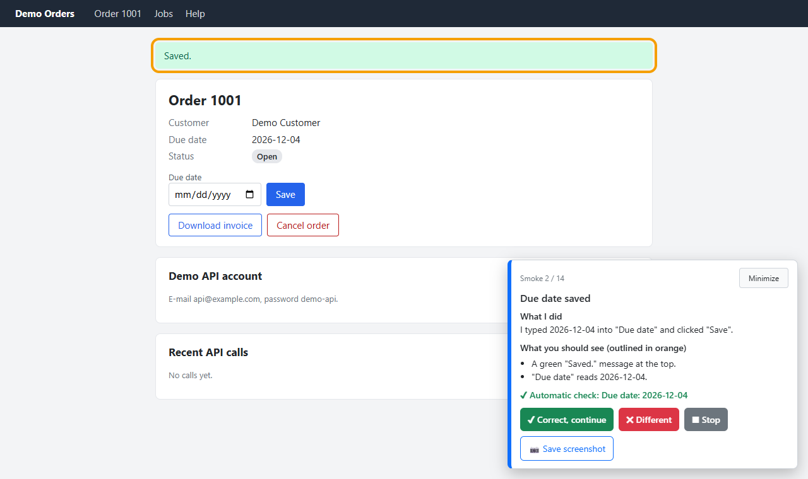
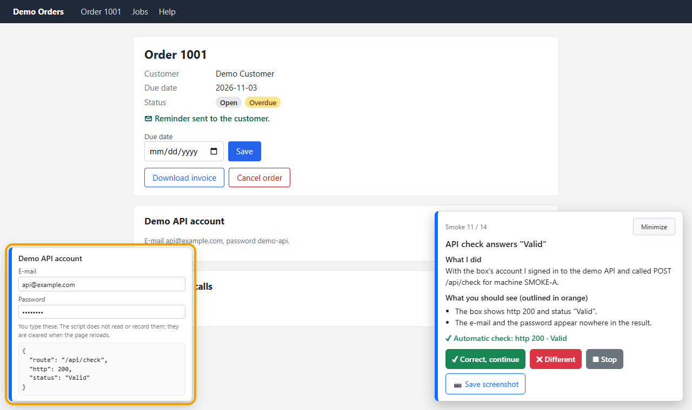

# guided-smoke

[](https://github.com/omrsyr/guided-smoke/actions/workflows/test.yml)

**A smoke test you can follow.** A Claude Code skill that walks you through a change in a real browser: Playwright
performs each step, a panel on the page tells you **what was done** and **what you should see** (outlined in orange),
and nothing moves on until you click **✔ Correct, continue**.

[Türkçe](README.tr.md)



Most browser-testing skills run tests on their own and hand you a result. `guided-smoke` is for the moment before a
change goes to review, when a person has to look at the screen and say "yes, that is right" — without reading a
checklist, clicking through it alone, or watching a script race past.

## What it does

- Claude writes a **plan** for the change you just made (from the conversation, the branch diff and the acceptance
  criteria) and shows it to you as a numbered list.
- After your OK a browser opens. For every step the script acts, outlines the spot, runs an automatic check and waits:
  - **✔ Correct, continue** · **✖ Different** (write a short note) · **■ Stop** · **📷 Save screenshot** · **Minimize**
  - When the automatic check failed, **✔** asks for a second click, and the report marks the step.
- Steps that change something **outside the page** (a database row, a file, an e-mail) ask first: **Yes, do it / Skip /
  Stop**. On a non-local address they are off unless you allow them.
- A step that calls an API with an account of its own asks you to type that account into a **value box** on the page.
  The call runs inside the page; the script never sees the values, and they are masked in what it gets back. If you
  move on before typing, the step waits for the box.
- Every answer is saved at once. The **report** lists what passed and what differed, the measured walk time, what
  changed since the previous walk, and a block to paste into your work item.
- After a fix, `run 6655 --retry-failed` runs only the steps marked ✖.

## Requirements

- Claude Code (or another agent with shell access) on Windows, macOS or Linux
- Node.js 20 or newer (the floor of Playwright; 20 itself is past its end of life, so 22 or 24 is the better choice)
- Google Chrome or Microsoft Edge (no browser is downloaded; the installed one is driven)

Every push runs the tests on Windows, macOS and Linux (GitHub Actions): the engine's tests, and the demo walked
headless in Chrome. Edge is driven the same way, but the hosted runners only test Chrome.

## Install

```bash
git clone https://github.com/omrsyr/guided-smoke ~/.claude/skills/guided-smoke
```

On Windows (PowerShell): `git clone https://github.com/omrsyr/guided-smoke "$env:USERPROFILE\.claude\skills\guided-smoke"`

Start a new Claude Code session. The first run asks to install `playwright-core` (a few MB, from npm) into the data
folder — not into the skill folder. You can also do it yourself: `node ~/.claude/skills/guided-smoke/engine/run.js setup`.

## Try it

```bash
node ~/.claude/skills/guided-smoke/engine/run.js setup     # once: playwright-core into the data folder
node ~/.claude/skills/guided-smoke/engine/run.js demo
```

A small demo application starts on 127.0.0.1 and a 14-step walk opens in your browser: sign in with the account shown
on the page, then follow the panel (about 5 minutes). It covers every kind of step: a form, a validation the browser
blocks, a download, a dialog, two permitted steps, a background job and API calls through the value box. Nothing
leaves your machine, and the demo forgets everything when it stops. In Claude Code you can also say
`/guided-smoke demo`.

## Use

Say "run a smoke for this" or type:

```text
/guided-smoke                     plan the smoke for the current work, show it, run it after your OK
/guided-smoke plan 6655           plan only (no browser)
/guided-smoke run 6655            run it (a new walk: 6655-machine-expiry-1, -2, …)
/guided-smoke run 6655 --retry-failed
/guided-smoke report 6655         report of the latest walk (6655-2 for walk 2)
/guided-smoke list
```

Useful flags: `--browser chrome|edge`, `--base https://localhost:5001`, `--pace slow|normal|fast`, `--from 5`,
`--only 3,7-9`, `--screens diff|all`, `--locale tr-TR` (default: your system's), `--skip-writes`, `--fresh`,
`--auto` (a step whose check passed goes on by itself after 3 s), `--panel left,min` (corner, start minimized),
`--video`, `--trace` (recordings in the walk folder; the value box is left out of the trace; `--video` needs
`run.js setup --video` once, about 4 MB). See [SKILL.md](SKILL.md).

## Sign-in and data

- **You sign in.** The script never sees a password; the browser's password saving is off in the smoke profile.
- The smoke uses its **own browser profile** per project and browser, so your everyday browser is untouched and you
  sign in once. `--fresh` uses a throw-away profile; "Sign out and clear the profile" on the closing screen deletes it.
- Plans, walks, reports and profiles live outside your repository:
  `%LOCALAPPDATA%\guided-smoke` (Windows), `~/Library/Application Support/guided-smoke` (macOS),
  `~/.local/share/guided-smoke` (Linux), or `GUIDED_SMOKE_HOME`.
- Recorded: step titles, your answers and notes, automatic-check texts, times. Never: page HTML, cookies, form values,
  credentials. Screenshots only when you ask.



## Writing plans

A plan is a small JavaScript module; Claude writes it, you can edit it. See
[references/writing-steps.md](references/writing-steps.md) and [examples/demo/steps.js](examples/demo/steps.js).

```js
{
  title: 'Due date saved',
  did: 'I typed 2030-01-31 into "Due date" and clicked "Save".',
  expect: ['A green "Saved." message appears.', 'Due date reads 2030-01-31.'],
  run: async ({ page, mark, submit }) => {
    await page.locator('#dueDate').fill('2030-01-31');
    await submit(page.locator('button[type=submit]'));
    await mark(page.locator('#order-card'));
  },
  check: async ({ page, text }) => [(await text(page.locator('#order-card'))).includes('2030-01-31'), 'Date shown.', 'Date not shown.'],
}
```

## Development

```bash
node --test engine/test/engine.test.js     # no browser needed
node --test engine/test/demo.test.js       # the demo walked headless in Chrome or Edge (needs setup)
node examples/demo/screenshots.js          # regenerate the screenshots in docs/
node engine/run.js doctor
```

## License

[MIT](LICENSE) © 2026 Ömer Soyer
