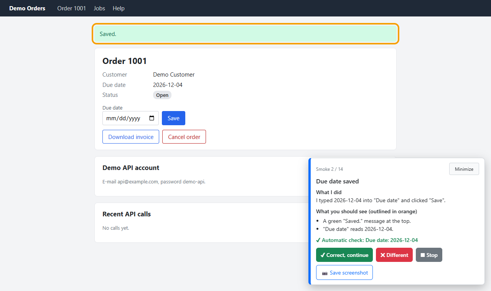
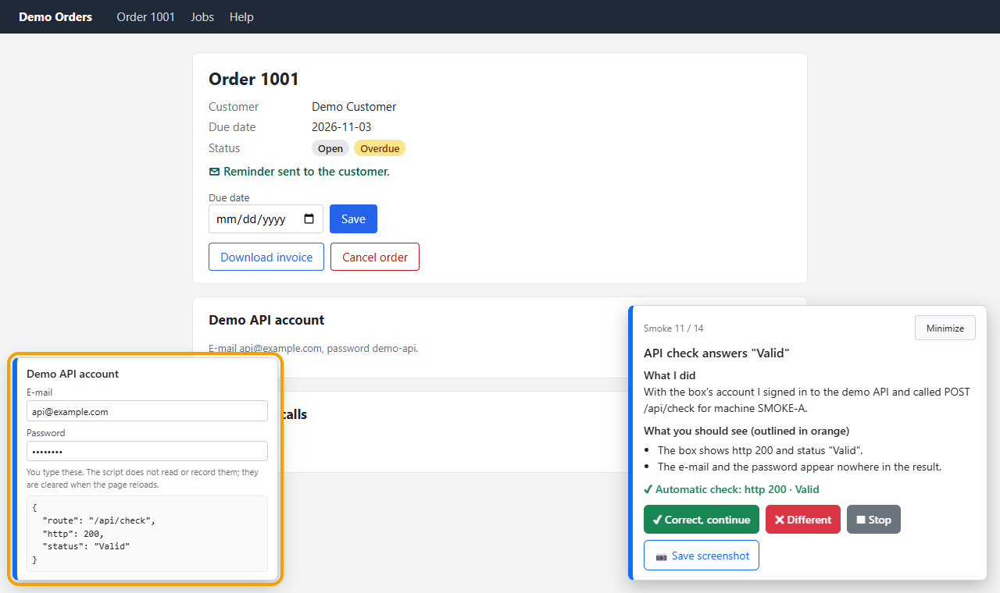

# guided-smoke

[](https://github.com/omrsyr/guided-smoke/actions/workflows/test.yml)

**Takip edebileceğin bir smoke ya da kabul testi (UAT turu).** Bir değişikliği gerçek bir tarayıcıda sana adım adım gösteren Claude Code
skill'i: Playwright her adımı kendisi yapar, sayfadaki panel **ne yapıldığını** ve **ne görmen gerektiğini** yazar
(ilgili yer turuncu çerçeveyle işaretlenir); sen **✔ Doğru, devam** demeden sonraki adıma geçilmez.

[English](README.md)



Tarayıcı testi yapan skill'lerin çoğu testleri kendisi koşar ve sana sonuç verir. `guided-smoke` ise bir değişiklik
incelemeye gitmeden önceki ana göre: birinin ekrana bakıp "evet, doğru" demesi gerektiği an. Bunun için kontrol
listesini okuman, tek başına tıklaman ya da hızla akıp giden bir betiği izlemen gerekmez.

## Ne yapar

- Claude az önce yaptığın değişiklik için bir **plan** yazar (konuşmadan, dalın farkından, kabul kriterlerinden) ve
  sana numaralı liste olarak gösterir.
- Onayından sonra tarayıcı açılır. Her adımda betik işi yapar, yeri işaretler, otomatik kontrolü koşar ve bekler:
  - **✔ Doğru, devam** · **✖ Farklı** (kısa bir not yaz) · **■ Durdur** · **📷 Ekran görüntüsü kaydet** · **Küçült**
  - Otomatik kontrol ✖ verdiyse **✔** ikinci bir tıklama ister; rapor o adımı işaretler.
- **Sayfanın dışında** bir şeyi değiştiren adımlar (veritabanı satırı, dosya, e-posta) önce sorar: **Evet, yap / Atla /
  Durdur**. Yerel olmayan bir adreste sen izin vermedikçe kapalıdır.
- Kendi hesabıyla bir API çağıran adım, o hesabı sayfadaki **değer kutusuna** yazmanı ister. Çağrı sayfanın içinde
  yapılır; betik değerleri hiç görmez, geri aldığı sonuçta da maskelenirler. Kutuyu doldurmadan ilerlersen adım kutuyu
  bekler.
- Panel her adımın altında ekranda göremediğini de gösterir: adım sırasında tarayıcının bildirdiği **JS hataları,
  konsol hataları ve başarısız istekler** (HTTP 4xx/5xx, hiç cevap almayan çağrı).
- Her cevap anında kaydedilir. **Rapor** geçeni ve farklı olanı, tarayıcının hata bildirdiği adımları, ölçülen koşu
  süresini, önceki koşudan bu yana neyin değiştiğini ve iş kaydına yapıştırılacak bir bloğu verir.
- Düzeltmeden sonra `run 6655 --retry-failed` yalnız ✖ işaretli adımları koşar.

## Gereksinimler

- Windows, macOS ya da Linux'ta Claude Code (ya da kabuk erişimi olan başka bir ajan)
- Node.js 20 ya da üstü (Playwright'ın alt sınırı; 20'nin kendi desteği bittiği için 22 ya da 24 daha iyi bir seçim)
- Google Chrome ya da Microsoft Edge (tarayıcı indirilmez; kurulu olan sürülür)

Her push'ta testler Windows, macOS ve Linux'ta koşar (GitHub Actions): motorun testleri ve Chrome'da headless demo
koşusu. Edge de aynı yolla sürülür, ancak GitHub'ın makinelerinde yalnız Chrome sınanır.

## Kurulum

İki yol var; skill aynıdır. İkisi birden varsa plugin, klonun önüne geçer.

**Plugin olarak**, güncelleme tek komutla:

```bash
claude plugin marketplace add omrsyr/guided-smoke
claude plugin install guided-smoke@omrsyr
```

Session içinde iki adım tektir: `/plugin install guided-smoke --marketplace omrsyr/guided-smoke`
(Claude Code 2.1.275 ve sonrası). Yeni sürüm `claude plugin update guided-smoke@omrsyr` ile gelir.

**Skill klasörü olarak**, güncelleme `git pull` ile:

```bash
git clone https://github.com/omrsyr/guided-smoke ~/.claude/skills/guided-smoke
```

Windows (PowerShell): `git clone https://github.com/omrsyr/guided-smoke "$env:USERPROFILE\.claude\skills\guided-smoke"`

Yeni bir Claude Code session'ı aç. İlk koşu `playwright-core`'u (birkaç MB, npm'den) veri klasörüne kurmak için izin
ister; skill klasörüne değil. İstersen kendin de kurabilirsin: `node <klasör>/engine/run.js setup`; klasör, klonda
`~/.claude/skills/guided-smoke`, plugin'de `claude plugin list` çıktısındaki `Read from` yoludur.

## Dene

```bash
node ~/.claude/skills/guided-smoke/engine/run.js setup     # bir kez: playwright-core veri klasörüne
node ~/.claude/skills/guided-smoke/engine/run.js demo      # plugin'de: aynı iki komut, plugin'in klasöründe
```

127.0.0.1'de küçük bir demo uygulaması açılır ve tarayıcında 14 adımlık bir koşu başlar: sayfada yazan hesapla giriş
yap, sonra paneli izle (yaklaşık 5 dakika). Her adım türü var: form, tarayıcının engellediği bir doğrulama, indirme,
pencere, iki izinli adım, arka plan işi, değer kutusuyla API çağrıları ve bilerek düşen bir arka plan çağrısı (panel gösterir). Makinenden hiçbir şey çıkmaz; demo
kapanınca her şeyi unutur. Claude Code'da `/guided-smoke demo` da diyebilirsin.

## Kullanım

"Bunun smoke'unu koşalım" de ya da yaz:

```text
/guided-smoke                     bu işin smoke planını hazırla, göster, onayınla koş
/guided-smoke plan 6655           yalnız plan (tarayıcı açılmaz)
/guided-smoke run 6655            koş (yeni koşu: 6655-machine-expiry-1, -2, …)
/guided-smoke run 6655 --retry-failed
/guided-smoke report 6655         son koşunun raporu (2. koşu için 6655-2)
/guided-smoke list
```

İşe yarayan bayraklar: `--browser chrome|edge`, `--base https://localhost:5001`, `--pace slow|normal|fast`, `--from 5`,
`--only 3,7-9`, `--screens diff|all`, `--locale tr-TR` (varsayılan: sistemin dili), `--skip-writes`, `--fresh`,
`--auto` (kontrolü geçen adım 3 sn sonra kendiliğinden geçer), `--panel left,min` (köşe, küçültülmüş başla),
`--video`, `--trace` (kayıtlar koşu klasöründe; değer kutusu izin dışında kalır; `--video` için bir kez
`run.js setup --video`, yaklaşık 4 MB). Ayrıntı: [SKILL.md](SKILL.md).

## Giriş ve veriler

- **Girişi sen yaparsın.** Betik parolayı hiç görmez; smoke profilinde tarayıcının parola kaydı kapalıdır.
- Smoke proje ve tarayıcı başına **kendi tarayıcı profilini** kullanır: günlük tarayıcın etkilenmez, girişi bir kez
  yaparsın. `--fresh` geçici profil kullanır; son ekrandaki "Çıkış yap ve profili temizle" profili siler.
- Planlar, koşular, raporlar ve profiller reponun dışında durur:
  `%LOCALAPPDATA%\guided-smoke` (Windows), `~/Library/Application Support/guided-smoke` (macOS),
  `~/.local/share/guided-smoke` (Linux) ya da `GUIDED_SMOKE_HOME`.
- Kayda giren: adım başlıkları, cevapların ve notların, otomatik kontrol metinleri, süreler; tarayıcı hatalarından
  yalnız tür, yöntem, yol (sorgusuz, kimlikler maskeli) ve durum kodu. Girmeyen: sayfanın HTML'i, çerezler, form
  değerleri, kimlik bilgileri, istek/yanıt gövdeleri, hata mesajları. Ekran görüntüsü yalnız sen istersen.



## Plan yazmak

Plan küçük bir JavaScript modülü; Claude yazar, sen düzenleyebilirsin. Bkz.
[references/writing-steps.md](references/writing-steps.md) ve [examples/demo/steps.js](examples/demo/steps.js).

## Geliştirme

```bash
node --test engine/test/engine.test.js     # tarayıcı gerekmez
node --test engine/test/demo.test.js       # demo, Chrome ya da Edge'de headless (setup gerekir)
node examples/demo/screenshots.js          # docs/ altındaki görüntüleri yeniden üret
node engine/run.js doctor
```

## Lisans

[MIT](LICENSE) © 2026 Ömer Soyer
